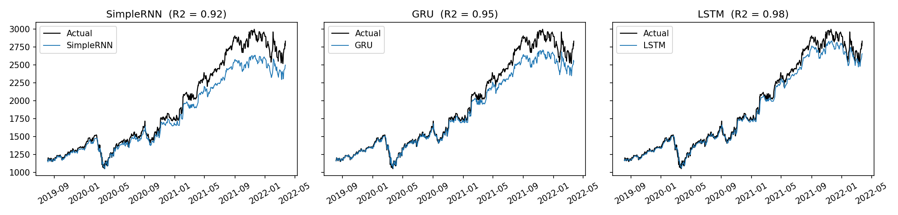
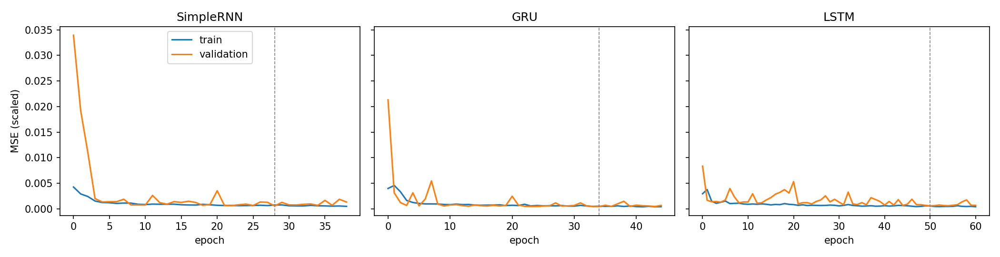

# DNN Project 2 — Group 1: Attention Mechanism

---

## Group Members

| Student ID | Name | GitHub |
|------------|------|--------|
| 11247371 | Phạm Bá Việt | [@davvph](https://github.com/davvph) |
| 11247291 | Lê Huy Hoàng | [@helian16](https://github.com/helian16) |
| 11247289 | Lương Thế Hiếu | [@adcc17](https://github.com/adcc17) |
| — | Bé Thành Tiên | [@Tienachilles](https://github.com/Tienachilles) |
| 11247287 | Chử Vũ Thảo Hiền | [@dqchien](https://github.com/dqchien) |

---

## Project Overview

This repository contains our midterm work for the Deep Neural Networks course:

1. **RNN Exercise**: time series forecasting with recurrent neural networks on historical Google stock data.
2. **Research Assignment (Topic 2)**: the Attention Mechanism in deep learning.

---


### Objective
Develop an RNN-based model to predict the next-day closing price of Alphabet Inc. (GOOGL) stock using the previous 30 trading days as input.

### Dataset
[Google Stock Data on Kaggle](https://www.kaggle.com/datasets/varpit94/google-stock-data) — historical daily OHLCV data for Alphabet Inc.

### Problem Formulation
Given an input sequence of 30 consecutive trading days:

$$X_t = [x_{t-29}, \ldots, x_t]$$

the model predicts the next-day closing price:

$$\hat{y}_{t+1} = f(X_t;\, \theta)$$

### Preprocessing
- Parse and sort by `Date` in chronological order
- Handle missing values
- Use `Close` price as the primary feature (optionally include `Open`, `High`, `Low`, `Volume`)
- Apply Min-Max normalization fitted on training data only
- Construct sliding-window sequences of length 30

### Data Split (chronological)
| Split | Proportion |
|-------|-----------|
| Training | 70% (earliest) |
| Validation | 15% |
| Test | 15% (most recent) |

### Model Architecture (SimpleRNN)
```
Input → SimpleRNN(64, tanh) → Dropout(0.2) → Dense(1)
```
- Optimizer: Adam
- Loss: Mean Squared Error (MSE)
- Early stopping on validation loss

### Optional Extensions
- GRU (Gated Recurrent Unit)
- LSTM (Long Short-Term Memory)

### Evaluation Metrics
| Metric | Description |
|--------|-------------|
| MAE | Mean Absolute Error |
| MSE | Mean Squared Error |
| RMSE | Root Mean Squared Error |
| R² | Coefficient of Determination |

> All metrics are computed after inverse-transforming predictions back to the original price scale.

---

## Repository Structure

```
DNN-project2-G1-Attention-Mechanism/
├── data/
│   ├── GOOGL.csv                  # raw dataset
│   └── processed/                 # sequences and scalers (output of 02)
├── code/
│   ├── 01_data_explore.ipynb      # inspect data, split, baseline
│   ├── 02_preprocessing.ipynb     # scaling, 30-day windows, saved arrays
│   └── 03_model_training.ipynb    # SimpleRNN / GRU / LSTM, evaluation
├── models/                        # trained models (output of 03)
├── results/                       # one folder per notebook
│   ├── 01_data_explore/
│   ├── 02_preprocessing/
│   └── 03_model_training/
├── slides/                        # research assignment presentation
└── README.md
```

---

## Setup

```bash
pip install numpy pandas scikit-learn tensorflow matplotlib joblib jupyter
```

Run the notebooks in order, from inside the `code` folder, because they read data with relative paths such as `../data/GOOGL.csv`:

```bash
cd code
jupyter notebook
```

Run `01_data_explore.ipynb`, then `02_preprocessing.ipynb`, then `03_model_training.ipynb`.

---

## Results

All numbers are on the chronological test set (665 trading days, 2019-08 to 2022-03), in USD after inverse scaling. Every model uses the same data, the same 30-day window and `Close` as the only feature. Raw outputs are in `results/03_model_training/`.

| Model | MAE | MSE | RMSE | R² |
|-------|-----|-----|------|----|
| Persistence baseline | 24.79 | 1,264.91 | 35.57 | 0.9967 |
| SimpleRNN | 130.44 | 30,423.37 | 174.42 | 0.9199 |
| GRU | 95.09 | 18,155.70 | 134.74 | 0.9522 |
| LSTM | 56.70 | 5,977.04 | 77.31 | 0.9843 |

Training stopped early on validation loss (patience 10): SimpleRNN after 39 epochs, GRU after 45, LSTM after 61.




### Findings

- **LSTM is the best of the three recurrent models** (RMSE 77 USD), followed by GRU (135) and SimpleRNN (174). The gated models handle the long climb in the test period better than the plain RNN.
- **No model beats the persistence baseline.** Predicting tomorrow's close as today's close gives an RMSE of 36 USD and R² of 0.9967. Stock prices are close to a random walk, so a high R² on price level is easy and not strong evidence of learned structure.
- **The models fall behind as the price rises.** Training prices never exceed 836 USD, but all 665 test days are above that, reaching about 2,997 USD. Predictions stay close to the actual price through 2020 and then drift below it (see `test_errors.png`), with errors of -300 to -400 USD for SimpleRNN by late 2021. LSTM drifts the least.
- **No classic overfitting.** Training and validation loss stay close together and flatten out, and early stopping triggers well before the 100-epoch limit. The weakness comes from the test prices lying outside the range the models saw, not from memorising the training set. The scaler is fitted on training data only, so test values scale above 1, and we did not clip or refit it because that would leak future information.

### Hyperparameter study (SimpleRNN, validation RMSE in USD)

One factor changed at a time around the baseline (64 units, learning rate 0.001, window 30). Selection used the validation set only. Each setting was run once with a single seed, so small differences are within noise.

| Factor | Value | Val RMSE |
|--------|-------|----------|
| Hidden units | 16 / 32 / 64 / 128 | 29.82 / 26.96 / 18.68 / 22.06 |
| Learning rate | 0.01 / 0.001 / 0.0001 | 170.03 / 18.68 / 78.75 |
| Epochs (no early stopping) | 5 / 20 / 60 | 28.82 / 22.81 / 21.12 |
| Sequence length (days) | 10 / 20 / 30 / 60 | 16.93 / 17.61 / 18.68 / 17.97 |

- **Hidden units:** 64 was the best of the four sizes. 16 and 32 underfit slightly, and 128 did not help.
- **Learning rate:** the clearest effect. 0.01 is unstable and 0.0001 is too slow to converge in time, so 0.001 is the right choice.
- **Epochs:** error keeps falling with more epochs, but early stopping (39 epochs, 18.68) beat a fixed 60 epochs (21.12) while training less.
- **Sequence length:** only a small effect, and the spread (about 1.8 USD) is smaller than what we would expect from changing the random seed, so we kept the required 30 days.

### Limitations

- The target is the raw price level, which is non-stationary. Modelling daily returns or price differences, or rescaling over a rolling window, would likely handle the rising price better. We did not try this.
- Only `Close` is used. The multivariate option (Open, High, Low, Volume) is available by changing `FEATURES` in `02_preprocessing.ipynb` but was not evaluated.
- Single random seed per run and a single train/validation/test split, so the ranking of close results could change with another seed.
- Trained models are saved in `models/` (`simplernn.keras`, `gru.keras`, `lstm.keras`).
