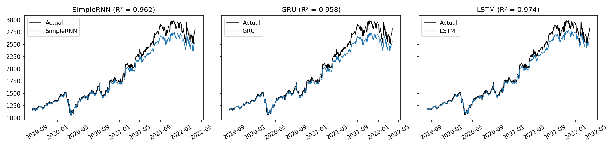
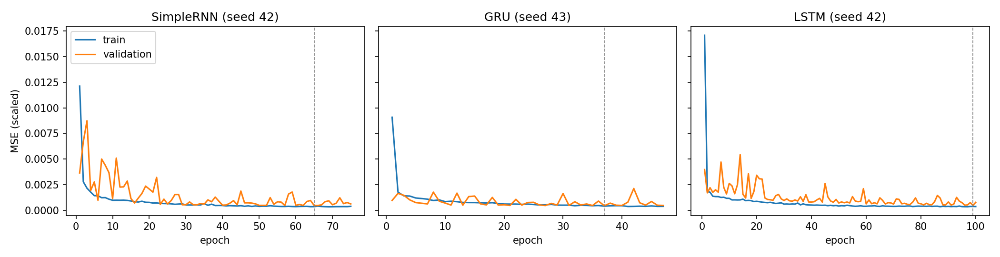

# DNN Project 2 — Group 1: Attention Mechanism

---

## Group Members

| Student ID | Name | GitHub |
|------------|------|--------|
| 11247371 | Phạm Bá Việt | [@davvph](https://github.com/davvph) |
| 11247291 | Lê Huy Hoàng | [@helian16](https://github.com/helian16) |
| 11247289 | Lương Thế Hiếu | [@adcc17](https://github.com/adcc17) |
| — | Bé Thành Tiên | [@Tienachilles](https://github.com/Tienachilles) |
| 11247287 | Chử Vũ Thảo Hiền | [@dqchien](https://github.com/dqchien) |

---

## Project Overview

This repository contains our midterm work for the Deep Neural Networks course:

1. **RNN Exercise**: time series forecasting with recurrent neural networks on historical Google stock data.
2. **Research Assignment (Topic 2)**: the Attention Mechanism in deep learning.

---


### Objective
Develop an RNN-based model to predict the next-day closing price of Alphabet Inc. (GOOGL) stock using the previous 30 trading days as input.

### Dataset
[Google Stock Data on Kaggle](https://www.kaggle.com/datasets/varpit94/google-stock-data) — historical daily OHLCV data for Alphabet Inc.

### Problem Formulation
Given an input sequence of 30 consecutive trading days:

$$X_t = [x_{t-29}, \ldots, x_t]$$

the model predicts the next-day closing price:

$$\hat{y}_{t+1} = f(X_t;\, \theta)$$

### Preprocessing
- Parse and sort by `Date` in chronological order
- Handle missing values
- Use `Close` price as the primary feature (optionally include `Open`, `High`, `Low`, `Volume`)
- Apply Min-Max normalization fitted on training data only
- Construct sliding-window sequences of length 30

### Data Split (chronological)
| Split | Proportion |
|-------|-----------|
| Training | 70% (earliest) |
| Validation | 15% |
| Test | 15% (most recent) |

### Model Architecture (SimpleRNN)
```
Input → SimpleRNN(64, tanh) → Dropout(0.2) → Dense(1)
```
- Optimizer: Adam
- Loss: Mean Squared Error (MSE)
- Early stopping on validation loss

### Optional Extensions
- GRU (Gated Recurrent Unit)
- LSTM (Long Short-Term Memory)

### Evaluation Metrics
| Metric | Description |
|--------|-------------|
| MAE | Mean Absolute Error |
| MSE | Mean Squared Error |
| RMSE | Root Mean Squared Error |
| R² | Coefficient of Determination |

> All metrics are computed after inverse-transforming predictions back to the original price scale.

---

## Repository Structure

```
DNN-project2-G1-Attention-Mechanism/
├── data/
│   ├── GOOGL.csv                  # raw dataset
│   └── processed/                 # sequences and scalers (output of 01)
├── code/
│   ├── 01_data.ipynb              # exploration + preprocessing: scaling, 30-day windows, leakage checks, split
│   ├── 02_model_training.ipynb    # baseline, SimpleRNN / GRU / LSTM, evaluation
│   ├── 03_direction_metrics.ipynb # directional accuracy, MAPE, Theil's U (supports the §8.6 discussion)
│   └── 04_skip_connection.ipynb   # supplementary experiment: predict the change, not the level
├── models/                        # trained models (02 writes *.keras, 04 writes skip_*.keras)
├── results/                       # one folder per notebook
│   ├── 01_data/
│   ├── 02_model_training/
│   ├── 03_direction/
│   └── 04_skip/
├── slides/                        # research assignment presentation
└── README.md
```

---

## Setup

```bash
pip install numpy pandas scikit-learn tensorflow matplotlib joblib jupyter
```

Run the notebooks in order, from inside the `code` folder, because they read data with relative paths such as `../data/GOOGL.csv`:

```bash
cd code
jupyter notebook
```

Run `01_data.ipynb`, then `02_model_training.ipynb`. Those two cover everything the assignment requires.

Notebooks 03 and 04 are supplementary, written to support the discussion of requirement §8.6. Neither changes the required pipeline. `03_direction_metrics.ipynb` retrains nothing — it loads the three saved models and runs in under a minute. `04_skip_connection.ipynb` trains three extra models with 5 seeds each and takes about 15 minutes.

---

## Results

All numbers are on the chronological test set (665 trading days, 2019-08 to 2022-03), in USD after inverse scaling. Every model uses the same data, the same 30-day window and `Close` as the only feature. Each architecture was trained with 5 seeds (42–46); the table gives mean ± standard deviation over those runs. Raw outputs are in `results/02_model_training/`, one row per run in `runs_per_seed.csv`.

| Model | MAE | MSE | RMSE | R² |
|-------|-----|-----|------|----|
| Persistence baseline | 24.79 | 1,264.91 | 35.57 | 0.9967 |
| SimpleRNN | 147.07 ± 52.88 | 46,753 ± 29,568 | 205.34 ± 75.75 | 0.877 ± 0.078 |
| GRU | 115.17 ± 24.57 | 25,925 ± 9,738 | 158.48 ± 31.79 | 0.932 ± 0.026 |
| LSTM | 74.71 ± 33.39 | 12,243 ± 11,704 | 102.97 ± 45.28 | 0.968 ± 0.031 |

RMSE on every split, so the baseline can be compared on the same days:

| Model | Train | Validation | Test | Val / persistence | Test / persistence |
|-------|-------|------------|------|-------------------|--------------------|
| Persistence baseline | 6.39 | 16.19 | 35.57 | 1.00 | 1.00 |
| SimpleRNN | 7.97 | 18.01 | 205.34 | 1.11 | 5.77 |
| GRU | 7.60 | 17.00 | 158.48 | 1.05 | 4.46 |
| LSTM | 7.87 | 18.75 | 102.97 | 1.16 | 2.90 |

Early stopping on validation loss (patience 10) ran on average 49.8 epochs for SimpleRNN, 48.8 for GRU and 84.2 for LSTM. LSTM reached the 100-epoch limit in 3 of its 5 seeds, so it was still improving when training ended.




The figures show the seed with the lowest validation loss, not the average. In the first figure SimpleRNN has a higher R² than GRU, while its mean test RMSE is 47 USD worse — read the ranking from the tables, not from one run.

### Findings

- **LSTM is the best of the three recurrent models** (mean test RMSE 103 USD), followed by GRU (158) and SimpleRNN (205). The gated models handle the long climb in the test period better than the plain RNN, and the gap between LSTM and SimpleRNN is wider than either standard deviation.
- **No model beats the persistence baseline**, on any split. Predicting tomorrow's close as today's close gives a test RMSE of 36 USD and R² of 0.9967. Stock prices are close to a random walk, so a high R² on price level is easy and not strong evidence of learned structure.
- **The models fall behind as the price rises.** Training prices never exceed 836 USD, but all 665 test days are above that, reaching about 2,997 USD. Predictions stay close to the actual price through 2020 and then drift below it (see `test_errors.png`). The split ratios show the same thing: on validation, which only just leaves the training range, the models are 1.05–1.16 times the baseline error; on test, which leaves it completely, 2.90–5.77 times.
- **Seeds matter more than one might expect.** Within a single architecture the test RMSE spans 120–280 USD for SimpleRNN, 122–187 for GRU and 72–181 for LSTM. A result from one seed would mostly measure the seed, which is why everything here is averaged over five.
- **Validation barely predicts test performance.** Across the 15 runs the correlation between validation and test RMSE is 0.34, and for GRU and LSTM the seed picked on validation is not the best one on test. Selection is only reliable while the selection data and the evaluation data cover the same range of prices, which this split breaks.
- **Underfitting, not overfitting.** Every model is worse than persistence on the *training* set as well (7.60–7.97 USD against 6.39), so none of them has even learned to match "tomorrow = today" on the data it was trained on. Training error rises to validation error by about 2.3×, but persistence rises by 2.5× over the same days, so that increase belongs to the data rather than to memorisation. The scaler is fitted on training data only, so test values scale above 1; we did not clip or refit it because that would leak future information.

### Hyperparameter study (SimpleRNN, validation RMSE in USD)

One factor changed at a time around the baseline (64 units, learning rate 0.001, window 30, early stopping). Selection used the validation set only. Each setting was run with 3 seeds; the table gives mean ± standard deviation. For reference, persistence scores 16.19 USD on the same validation days — no setting below beats it.

| Factor | Value | Val RMSE |
|--------|-------|----------|
| Hidden units | 16 / 32 / 64 / 128 | 28.88 ± 7.56 / 19.71 ± 0.95 / 18.02 ± 1.13 / 17.50 ± 1.76 |
| Learning rate | 0.01 / 0.001 / 0.0001 | 36.35 ± 32.51 / 18.02 ± 1.13 / 30.32 ± 5.26 |
| Epochs (no early stopping) | 5 / 20 / 60 | 52.78 ± 10.36 / 28.48 ± 8.81 / 24.00 ± 6.56 |
| Sequence length (days) | 10 / 20 / 30 / 60 | 17.29 ± 0.25 / 18.64 ± 2.91 / 18.02 ± 1.13 / 18.83 ± 2.70 |

- **Hidden units:** error falls as the layer widens, but with diminishing returns — 16 → 32 is worth 9 USD, 64 → 128 only 0.5 USD, which is inside the seed noise. Capacity is not what limits these models.
- **Learning rate:** the clearest effect. 0.01 is unstable (standard deviation 32.51, almost as large as the mean) and 0.0001 is too slow to converge in time, so 0.001 is the right choice.
- **Epochs:** error keeps falling with more epochs, a sign of underfitting rather than overfitting. Early stopping (47.7 epochs on average, 18.02) still beats a fixed 60 epochs (24.00), because it restores the weights of the best epoch instead of the last one.
- **Sequence length:** a 10-day window scores slightly better than the required 30 (17.29 against 18.02) and is by far the most stable (± 0.25). The difference is within noise, but 30 days is clearly not better than 10 — consistent with most of the predictable information sitting in the last few days.

### Does the model know which way the price will move?

MAE, MSE, RMSE and R² all measure *how far* a prediction is from the actual price, and on a trending series they flatter anything that simply follows the price. `03_direction_metrics.ipynb` adds three measurements that ask a different question. Numbers below are for the seed each architecture saved, so one run per model.

| | Directional accuracy (test) | Predicted "up" | Debiased DA | corr(predicted Δ, actual Δ) | MAPE | Theil's U |
|---|---|---|---|---|---|---|
| Persistence | 44.1 % | 0 % | — | — | 1.34 % | 1.00 |
| SimpleRNN | 45.1 % | 3.5 % | 51.6 % | 0.037 (p = 0.34) | 3.82 % | 3.38 |
| GRU | 46.5 % | 4.8 % | 51.6 % | 0.038 (p = 0.33) | 3.91 % | 3.55 |
| LSTM | 47.2 % | 6.2 % | 52.5 % | 0.052 (p = 0.18) | 3.16 % | 2.79 |
| *Always "up"* | *55.9 %* | *100 %* | | | | |

- **No model has directional skill.** Test accuracy is 45–47 %, below a coin flip and far below the 55.9 % that answering "up" every day would score. On validation it is 47–53 %, and nothing in the notebook is significantly different from chance.
- **Below-chance accuracy is a bias, not an inverted signal.** The models predict a fall of 64–83 USD *every day* while the price actually rises 2.5 USD a day on average, so they answer "down" on 94–96 % of test days. Inverting them would just answer "up" every day, which is the majority class.
- **Nothing is hidden under that bias.** Remove the median predicted change and accuracy returns to chance (48.7–52.5 %); the correlation between predicted and actual daily change runs from −0.018 to 0.055 and not one of the twelve values is significant.
- **Persistence is the wrong baseline for this metric.** Its predicted change is exactly zero every day, so it never says "up" and degenerates into "always down". It is the right baseline for RMSE and meaningless here.

This separates two problems that the four required metrics conflate:

| Problem | Evidence | Where | Fixable? |
|---|---|---|---|
| Target leaves the training range | Theil's U 2.8–3.5; mean predicted change −64 to −83 USD | Test only | Yes, by predicting the change rather than the level |
| The series is close to a random walk | Directional accuracy at chance, correlation ≈ 0 | **Validation and test alike** | No — a property of daily closing prices |

The second row is the point. On validation the bias is almost absent and Theil's U is 1.01–1.06, so the models nearly tie the baseline on RMSE — and there is *still* no directional skill. Fixing the extrapolation problem would improve RMSE substantially but would not create directional skill.

### Supplementary experiment: predicting the change instead of the level

`04_skip_connection.ipynb` tests the diagnosis above directly. One line changes — the output is added to the last close of the input window, so the network learns the one-day change instead of the price level — and everything else stays identical: same data, split, scaler, seeds and training procedure.

```python
# notebook 02:  prediction = Dense(1)(h)
# notebook 04:  prediction = last_close_in_window + Dense(1)(h)
```

The target is still the next day's closing price, as §4.6 requires. The architecture is not the one §6.1 prescribes, so this is an addition for the §8.6 discussion and **not** a replacement for the result reported above.

| Model | Notebook 02 | Notebook 04 (skip) | Improvement | vs persistence |
|-------|-------------|--------------------|-------------|----------------|
| SimpleRNN | 205.34 ± 75.75 | **38.47 ± 3.59** | 5.3× | 1.08× |
| GRU | 158.48 ± 31.79 | **38.95 ± 4.49** | 4.1× | 1.10× |
| LSTM | 102.97 ± 45.28 | **37.51 ± 2.48** | 2.7× | 1.05× |
| Persistence baseline | 35.57 | 35.57 | — | 1.00× |

- **The diagnosis is confirmed.** The gap to the baseline falls from 2.90–5.77× to 1.05–1.10×. Since nothing but the architecture changed, the original gap can only have come from the network having to produce the price level through a bounded `tanh` state. Capacity was never the bottleneck.
- **Seed variance collapses** from ±75.75 / ±31.79 / ±45.28 to ±3.59 / ±4.49 / ±2.48, and the three architectures become indistinguishable from each other.
- **Training and validation now tie the baseline** (train 6.40–6.57 against 6.39, validation 16.19–16.38 against 16.19), so the underfitting noted above is gone.
- **They still do not beat persistence.** GRU with seed 45 is the clearest case: early stopping restored the weights of *epoch 1* and scored 35.564 USD against the baseline's 35.566 — the network found that predicting "no change" was as good as anything it could reach.
- **No directional skill appeared**, as `03_direction_metrics.ipynb` predicted. Test accuracy is still 42.7–44.4 % and the correlations are −0.015 to 0.021 (p = 0.60–0.88). A smaller downward bias remains: −8 to −12 USD per day against an actual +2.5, seven times smaller than before but not zero.
- On *validation* the correlations are 0.088–0.107 with p = 0.006–0.023, which looks significant but is not trustworthy: early stopping and seed selection both use the validation set, so a metric computed on it is optimistically biased. The test set is the only clean estimate.

### Limitations

- The target is the raw price level, which is non-stationary. Modelling daily returns or price differences, or rescaling over a rolling window, would likely handle the rising price better. We did not try this.
- Only `Close` is used. The multivariate option (Open, High, Low, Volume) is available by changing `FEATURES` in `01_data.ipynb` but was not evaluated.
- A single chronological train/validation/test split. Five seeds per architecture and three per hyperparameter setting, which is enough to see that the spread is large but not to separate settings that differ by about a standard deviation.
- Trained models are saved in `models/` (`simplernn.keras`, `gru.keras`, `lstm.keras`).
